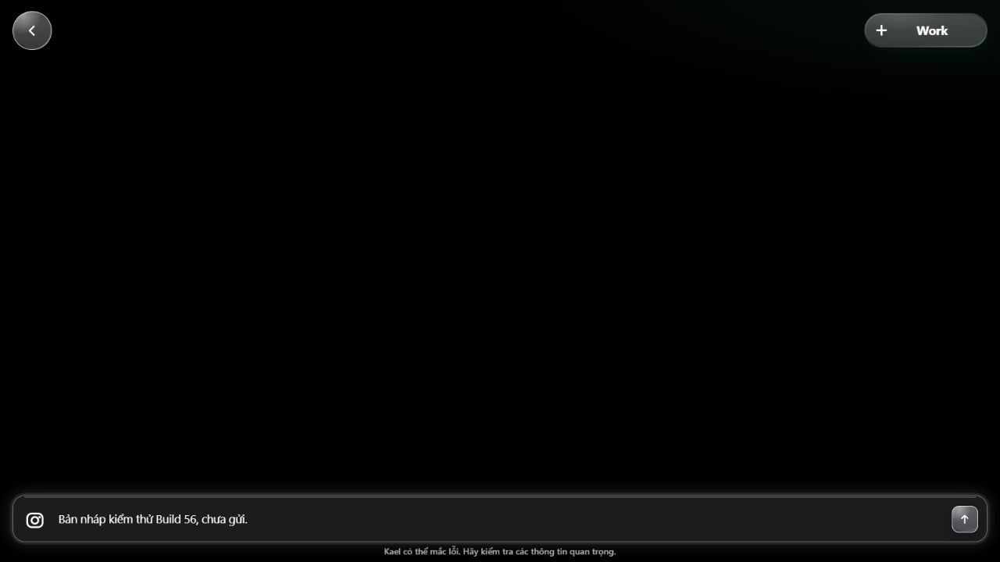

# Isolated local QA runtime — guarded startup and HTTP evidence

The initial attempts below were blocked. The continuation checkpoint at the end
records a successful guarded startup and limited HTTP-to-database evidence.

## Target and scope

Worktree: <repo>/.claude/worktrees/kael56-admin-partial-loading-20261016
Branch: codex/kael56-admin-partial-loading-20261016
Baseline: e8b95d2122a8ce802c5504630a778f6e51daa72f plus uncommitted diff.
Question/class: run isolated Auth/REST/Edge with actual PostgreSQL without
resetting the shared stacks — behavior, Lane A. No hosted deployment.

Optional --instance and --port-base select a named CLI project and canonical
empty-reset snapshot. Default stack and hosted migration planning keep their
own identities. Dedicated target: nestscout-qa-journey56-20261016, base 58320.
Actual source snapshot: 453 canonical migrations and 557 tracked function/Shared
source files, checksummed. Tracked environment files are rejected; untracked
files are not copied. New untracked Edge files are outside this snapshot proof.

Docker: 29.8.2; Compose 5.6.0. Official stable updater route returned
updated-or-current, one update attempt; .scratch/qa-docker-version.log. No Docker
Desktop launch/restart, RAM recovery, shared stop/reset, prune or host repair.
Each diagnosed attempt had one doctor and one CLI start; RAM was informational.

## Actual attempts

1. Internal QA bridge: PostgreSQL host initialization could not connect. A tiny
   owned HTTP control proved internal response but no published host port. Named
   resources only; no inference or Production data.
2. CLI 2.98.2 on a bridge with the documented loopback option: canonical replay
   and seed succeeded, but actual DB/Kong bindings were 0.0.0.0 and ::. Named
   stop exited 0, preserved backup. Bootstrap was not acceptance.
3. Official pinned CLI 2.121.0: startup refused missing configured function
   entry points in the temporary migration workdir; CLI stopped owned containers.
4. Checksummed tracked functions added: startup then identified the missing
   packages/shared/src/worker-capability-data.ts imported by the Edge worker
   contract. That sole external source dependency was added to the snapshot.
5. Final start restored the owned QA backup and completed CLI startup. Actual
   binding verification again rejected non-loopback DB/API ports; the automatic
   exact named stop exited 0 and the up runner exited 1 at
   2026-10-15T19:18:51.748Z. No owned QA containers remained running afterward.

Safe logs/results remain under .scratch/qa-stack-up*. No credential output is
in this packet. Provider secret prefixes are removed from the startup child;
the bridge is not an egress firewall and future function fixtures must deny
real inference independently. No business handler was exercised by these starts.

## Source and test evidence

- corepack pnpm install --frozen-lockfile: exit 0 using repo-pinned pnpm 10.16.1.
  The first noninteractive invocation refused module replacement; the retry used
  CI=true in its own shell. Only this isolated worktree dependencies changed.
- Official supabase package pinned exactly to 2.121.0; wrapper version read 2.121.0.
  Global pnpm 11 rewrote unrelated lock layout initially; its lock was preserved
  under scratch, and the final lock was generated from HEAD using pinned pnpm 10.
- Tracked-source-copy regression: failed ENOENT before copy, passed after; the
  external Shared dependency assertion separately failed then passed. Reuse,
  stale/copy tampering, refresh preservation and tracked .env refusal are tested.
- Combined infrastructure suites: 49 tests, 48 PASS / 1 SKIP / 0 FAIL, exit 0.
  Skip is an existing Windows native-Docker fixture host-policy limitation.
  The earlier run with 48/48 predates the extra source-copy test and is historical.
- Docker contracts: 22 files checked, exit 0.
- All Node script/harness tests before the final source-copy addition: 634 tests,
  633 PASS / 1 SKIP / 0 FAIL. Final full rerun is recorded separately below.

## Review

Fixed point: e8 plus uncommitted diff; git diff HEAD, no additional commits.
Spec: isolates target/ports and preserves other resources; source snapshot now
contains the configured entry points. Runtime acceptance remains blocked.
Rules: no hosted mutation, provider secret, pricing/learning/receipt deletion,
second deployment runtime, global process repair or weakened binding gate.
Maintainability: existing CLI and workdir materializer reused; optional selection
and actual-binding guard are tested. New dependency and copied-source inventory
are explicit. Linux execution has fixture/static evidence only on this Windows
host; hosted inference/financial/network outage are not tested by startup.

Result: PARTIAL. Task status: BLOCKED.
Stop reason: actual loopback publication differs from bridge option under the
current Docker/CLI combination. No identical retry is scheduled.
Unanswered: full local Edge-to-PostgreSQL HTTP journeys with guarded fixtures.
SQL behavior is separately proved by 138/138 files on the earlier private DB;
that result is not upgraded to HTTP end-to-end acceptance.

## Final source verification

Full Node script/harness rerun after the source-copy changes: 635 tests,
634 PASS / 1 SKIP / 0 FAIL, exit 0 (qa-all-node-final.log). All eight static
gates in final-static-results.json exited 0. Harness assurance verification
exited 0. Build initially failed because nested Turbo selected global pnpm 11
against the pnpm 10 dependency graph. A Corepack shim created only under ignored
scratch selected 10.16.1 for nested invocations; the same root build then passed
(1 API build task, exit 0; campaign-build-pinned-final.log). No native binary
was built. No global pnpm or host configuration was changed.

ship:check executed after final changes: all 10 source/harness/script gates
pass, but overall exit 1 / NOT READY because the campaign fixes are deliberately
uncommitted. This campaign prohibits publication; no commit was created to
satisfy that gate. This is a Git readiness limitation, not a passed ship gate.

Runner note: after ship verifier reported its exit-1 Git-state failure, the outer
PowerShell remained alive with no verifier child. Only that exact task-owned
shell was stopped; tool session exit was -1 from this cleanup. The source
verifier result and outer-shell termination are distinct evidence.

## Continuation — explicit binding and real HTTP intake

Continuation baseline: published branch commit `bc5ed76807ab7223631fec44e8440a1674f05f72`
plus the uncommitted QA adapter. Production and the frozen Build 56 Previews
were not modified. No additional commit, push, merge or deployment was performed.

A disposable Alpine control reproduced the binding discrepancy: publishing
`58329:8080` on the owned bridge produced `0.0.0.0` and `::`; explicitly publishing
`127.0.0.1:58329:8080` produced loopback only. The first control used an absent
`httpd` executable; the corrected sleeping control exercised publication without
serving data. Every control container was stopped and removed by its recorded ID.

A Node-only adapter passed its control but did not affect Supabase's compiled
binary. The resulting startup was rejected by the unchanged binding guard and
the exact named QA stop retained its backup. Inspection established that the npm
entry point launches a Bun executable. The adapter now uses the runtime's
documented [standalone preload support](https://bun.com/docs/bundler/executables),
scoped to this CLI child. It validates the QA name, project label, network and
port range, refuses foreign publication and publish-all, and preserves unrelated
commands. A real Bun/Docker control passed before another diagnosed start.

Guarded startup then exited 0. Actual DB and Kong bindings were respectively
`127.0.0.1:58322` and `127.0.0.1:58321`. Auth health returned 200. The first Edge
request exposed the CLI's internal `http://kong:8000` URL being treated as a
remote target by the App environment guard. The dedicated QA adapter now routes
that Edge container through `http://host.docker.internal:58321` and forces the
existing AI kill switch on. No product environment guard or handler was changed.
After an exact named stop/restart, startup and the binding guard again exited 0.
Auth and Edge health returned 200. Edge correctly reports local, unregistered and
degraded; this is not a fabricated Production release identity.

Three diagnosed Supabase starts occurred in this continuation: the Node-only
attempt failed the binding gate; native preload passed binding but exposed the
Edge environment issue; the local-gateway configuration passed startup and HTTP.
Each used one doctor and one CLI start, with a successful version check. There
was no identical blind retry, shared reset, host repair or paid service setup.

### HTTP and PostgreSQL evidence

The local-only script `.scratch/qa-http-deferred.mjs` uses actual Auth sign-in,
Edge handlers and PostgreSQL. It created two Customer fixtures for the final
run and exercised all six supported services with `defer_analysis=true`:
create 201, owner read 200, request-ID replay 201 with the same session ID, and
foreign-owner access denied. It uses the documented web-preview identity and
allowed localhost origin; no iOS identity was fabricated.

An initial missing-header request returned 426 as designed. A first six-service
run reached the five-per-minute creation limit and returned 429 on the sixth;
the final run uses the second fixture actor for that independent scenario.
Neither compatibility nor rate-limit enforcement was weakened. Earlier local
fixture accounts and the five earlier sessions are retained, not hard-deleted.

Independent `psql` readback for the final two actors found exactly six sessions,
six turns, zero linked jobs, total recorded AI cost zero and zero provider-log
rows since the run began. The Edge container had no inference provider keys and
its kill switch was verified true. This is evidence for deferred persistence,
read/replay and ownership only. Pricing, model responses, matching, scope change,
completion and settlement remain outside this checkpoint's HTTP proof.

Safe private results: `.scratch/qa-http-deferred-result.json`, the two retained
426/429 result files, `.scratch/qa-gateway-up-result.json`, and
`.scratch/qa-native-loopback-tests.log`. Do not publish runtime keys or fixture
credentials. The script's ephemeral execution is not a registered integration
pillar and must not be represented as full campaign runner acceptance.

Current targeted tooling suite: 42/42 before the final gateway test; the final
network suite is 12/12. Docker contracts checked 22 files; Node syntax and comment
discipline passed. Structure, baseline, test collection and pillar registry each
exited 0. Full tooling rerun and final lifecycle cleanup are recorded next.

Final full Node tooling runner (`node --test scripts/*.test.mjs
scripts/harness/*.test.mjs`): 641 executed, 641 passed, zero failures or skips,
exit 0. Comment discipline, diff whitespace, and workplan each exited 0; the
workplan contains seven closed slices and nine declared changed files. The
exact named QA stop exited 0 and preserved its backup. The temporary control
containers were removed. No shared instance was stopped.

Review fixed point is `git diff bc5ed76807ab7223631fec44e8440a1674f05f72`
plus the two new preload/launcher files. Spec: the formerly blocked loopback
startup and initial HTTP persistence now have real runtime evidence. Rules:
no global Docker change, guard bypass, provider credential or hosted mutation.
Maintainability: the existing QA network helper and startup/down ownership are
reused; the explicit CLI version check refuses an unsupported launcher rather
than silently accepting a changed upstream runtime. Other CLI versions and
non-Windows runtime behavior remain unverified. These local adapter changes
have not been committed or pushed.

Final `node scripts/harness/verify.mjs` exited 0. Its static transaction catalog
still prints historical release-gap strings; they are not fresh hosted facts
and were not used as current Production acceptance evidence. The final workplan
also records the approved memory checkpoint: eight closed slices, eleven changed
files. No new test/build claim is inferred from the memory write.

The campaign remains IN_PROGRESS. Next: promote the limited HTTP runner into
registered integration coverage, then verify quote/matching/scope/completion/
payment/recovery with provider fixtures. Live model spend enforcement and real
payment settlement are still separate open items. Native device QA belongs to Tu.

## Registered HTTP intake and scope-decision checkpoint

Baseline for this checkpoint: `33b97afc55413897afbe8d76228917089db45967`,
branch `codex/kael56-admin-partial-loading-20261016`, plus the uncommitted test
diff. The preceding QA adapter was committed and pushed at Tu's request; no
merge occurred. This continuation has no further commit/push or hosted changes.

Delegation: local, no subagents. Question: behavior through actual local Auth,
Edge and PostgreSQL. Lane A, exact instance `journey56-20261016`, base `58320`.
Version check: Docker 29.8.2, Compose 5.6.0; official stable update returned
updated-or-current, exit 0. One `up` owned the sole doctor and CLI start, exit 0.
Available RAM was 2.18 GB, informational. Actual loopback binding guard passed.

### Registered behavior and mutation evidence

`P391-kael-local-http-intake` now runs through Vitest rather than an ephemeral
script. Its first execution passed 8/8 with actual Auth sign-in, all six deferred
service intakes, same-request replay, owner readback, foreign-owner denial, and
persisted six-session/six-turn/no-linked-job/no-recorded-spend assertions.

Its mutation changed only the handyman replay to use a new request ID. Six tests
passed and two failed: the replay identity changed and the DB contained seven
sessions rather than six. Exact source restoration returned 8/8 pass.

`P392-kael-local-http-scope-decision` adds actual public Edge decisions and DB
readback. Fixtures start at stored quotes and a prior approved financial receipt.
They do not prove the upstream quote-generation or proposal path. No handler,
RPC, migration, pricing policy or permission was changed to make them pass.

Initial fixture failures were correctly enforced boundaries: committing a final
price without bilateral evidence returned SQLSTATE 23514; direct incident REST
insertion returned 42501. Fixture setup now uses one local PostgreSQL transaction
with the prior receipt. Its COMMIT executes the deferred final-price constraint;
no trigger or constraint is disabled. Public workflow decisions still use real
Customer/Worker JWTs, not service-role HTTP calls.

Final runtime suite: 15/15 passed, zero skips, exit 0:

- The eight intake cases remain green after extracting their shared local harness.
- Worker and foreign Customer cannot decide; the pending job remains unchanged.
- Customer rejection resumes `arrived`, preserves the original price and Worker;
  repeated or opposite decisions return the existing explicit 409 refusal.
- Concurrent approvals produce one 200 and one 409, one committed outcome,
  one Customer-decision audit event and one persisted Worker notification.
- Pre-arrival approval resumes `worker_matched` or `worker_on_way`; on-site
  approval resumes `repairing` and persists the stored quote total.
- A pending scope with unconfirmed quote evidence is refused by PostgreSQL;
  the failed setup transaction leaves no partial job.
- Approval racing rejection commits exactly one outcome with corresponding price,
  status and one persisted decision notification.

The ownership mutation substituted the owning Customer token in the foreign
attempt. In the then-11-case suite it caused exactly that denial assertion to
fail (10 pass, 1 fail); restoration returned 11/11. The later four cases expanded
timing, quote validation and conflicting-decision coverage; final suite 15/15.
This mutation proves the tested input/ownership assertion is live; it is not a
claim that a deployed authorization guard was removed or Production mutated.

Independent `psql` readback for the final execution found six fixture jobs:
one pending, one `arrived`, two `repairing`, one `worker_matched`, and one
`worker_on_way`, with prices matching the winning outcomes. Zero provider-log
rows were created during the run. Local Edge had its verified AI kill switch
and no inference credentials. These are limited runtime observations, not a
substitute for every remaining provider-fixture network-guard scenario.

### Runner provenance and cleanup

All commands below use this worktree as cwd and the baseline/diff above:

| Command | Observed result |
|---|---|
| `node scripts/run.mjs docker/scripts/ensure-version` | exit 0 |
| `node scripts/run.mjs docker/scripts/up --profile lean --instance journey56-20261016 --port-base 58320` | exit 0, actual loopback pass |
| `node scripts/harness/run-local-qa-http.mjs --instance journey56-20261016 --port-base 58320` | final 15 pass / 0 fail / 0 skip, exit 0 |
| `node node_modules/typescript/bin/tsc --noEmit -p apps/api/tsconfig.json` | exit 0 |
| `node apps/api/scripts/test-runner.mjs --reporter=json --outputFile=<absolute ignored report>` | Vitest 2174 pass / 0 fail / 17 skip; Node 114 pass / 0 fail / 1 skip; exit 0 |
| `node scripts/harness/verify.mjs` | exit 0; static historical release-gap prose is not fresh hosted evidence |
| `node scripts/harness/pillar-registry.mjs --write` | 386 unique pillars, manifest copies identical; exit 0 |
| `node scripts/check-test-collection.mjs` | 14/14 CI filters resolve; exit 0 |
| `node scripts/lint-structure.mjs` | exit 0 |
| `node scripts/check-comment-discipline.mjs` | exit 0 |
| `node scripts/run.mjs docker/scripts/down --instance journey56-20261016` | exit 0, backup retained |

The default API runner does not receive the named QA target. Fifteen of its
seventeen Vitest skips are the explicit-target HTTP cases executed separately
above; neither skip nor the registry count is treated as runtime PASS. Full
Mobile, Shared, build, Edge type and complete SQL-matrix gates were not rerun for
this test-only diff and remain outside this checkpoint's verification claim.

Final private runner artifacts and SHA256:

| Artifact under `.scratch/` | SHA256 |
|---|---|
| `qa-http-registered-green.json` | `C31B74EF048C5ED4326F6E3DFC5AE3A3F0E9EDEBF28168637EE748532A99CA6D` |
| `qa-http-registered-mutation.json` | `36F36131F0974817447E3580C81D3AD2DDAA31330961FE7422427117830B8E36` |
| `qa-http-registered-restored.json` | `A6549F87AE4C698D62B3A4A46B14AD102FDF6678EA22ACCE9BC3DB8C2094DB13` |
| `qa-http-scope-mutation.json` | `9B0D580A35B4572AC9D198D99929C65798D7816FB960FCD20C2B2ACF2D47449D` |
| `qa-http-scope-restored.json` | `71E10CE026B408FF7441BDBDB977B9E48BC0A21ADFD2375B56C89B01B9E4C1B5` |
| `qa-http-scope-expanded-final.json` | `7136ED5E398CF70E61533C660CCE183308B3A63EF8A5979CA750D8BBD5CE4305` |
| `qa-http-scope-psql-readback.log` | `192BAE9CAD0DE12C18871785C1188D97ADEC9BF802F8141BB05591073F1D49C3` |

Post-cleanup inspection found zero running containers for the exact QA project.
Fixture records and backups are retained. Preview listeners remain the original
PIDs 24036/1460 on ports 8085/8086. The Customer browser still renders the frozen
`e8b95d2122a8` marker and retains its unsent draft.

Campaign status remains IN_PROGRESS. Fresh quote/proposal, complete matching,
completion/payment/recovery journeys, remaining direct Preview scenarios and
live AI budget enforcement remain open. A 409 already-decided response is the
current observed contract; it is not proof of receipt-return recovery in the
frontend after a lost response. No whole-journey, native or hosted PASS follows
from this checkpoint.

Review fixed point: uncommitted `git diff 33b97afc55413897afbe8d76228917089db45967`
plus the new scope pillar and local test harness. Spec compliance: registered
intake and scope decisions now have the previously missing real HTTP/DB seam;
remaining full-journey requirements are explicitly open. Rules compliance:
guarded local targets, retained evidence, no inference keys, no hosted or binary
change, no new Git publication. Maintainability: the two pillars share one
bounded local HTTP/Auth/fixture helper; fixture SQL has a table/column allowlist,
checks actual owned bindings, and commits with all constraints enabled.

Final comments, structure baseline and diff checks exited 0. Workplan validates
11 closed slices and eight declared changed files. Scratch measured 33.4 MiB;
nothing was deleted. This is a checkpoint in the active campaign, not a release
or a complete-plan acceptance claim.

## Provider-fixture transport boundary

The next full-journey seam needs scripted provider replies while retaining actual
Auth and PostgreSQL. `scripts/harness/local-provider-fixture.mjs` is test tooling
only. It permits selected paths on an explicitly configured local Supabase
origin, refuses redirects in the captured native transport, answers only the
exact Anthropic messages endpoint in memory, and refuses every other destination.
No actual provider network request is forwarded. Counters contain only totals.

Observed TDD: initial implementation refused all use and all four initial tests
failed. The implemented boundary passed the initial four and two added cases:
oversize request refusal/counter isolation, and a real loopback HTTP POST plus
actual redirect refusal. Final targeted Node suite is 6/6, exit 0.

Mutation: allowing unknown destinations to reach the injected transport made
the foreign-target denial case fail, exit 1. Its transport was a test stub,
so the mutation did not send any external request. Source restoration returned
6/6, exit 0. Private logs: `.scratch/provider-fixture-{red,green,mutation,restored}.log`.

This proves the transport boundary under Node. A dedicated Deno QA function,
its runtime installation, real quote preview/proposal and complete matching
remain unverified at this point. This checkpoint does not count those as passed.

## Dedicated Deno scope fixture installation

The guarded installer writes an ignored, named QA function beside the copied
canonical functions. It verifies the exact local migration plan, port base,
canonical entry/config bytes, running project, actual loopback bindings, AI kill
switch and absence of inference credentials before writing. The original
`mobile-api` entry remains unchanged. The function uses the actual authenticator,
handler, services and database; only provider transport and its fixture-only
configuration differ. No product workflow response is intercepted.

Installer TDD began with three failing cases, then passed 3/3. A generated-entry
syntax check caught an escaped-regex error and passed after correction. Combined
network, installer and QA CLI refusal tests passed 21/21, exit 0.

Actual runtime observations changed the next action twice. Adding a directory
after startup returned 404 because the CLI snapshots the function list. The
installer now registers only its named QA function and an explicitly empty env
file. The scoped CLI adapter permits only the exact official local `functions
serve` invocation with that registration, and retains all existing startup guards.
No general arbitrary CLI command, env-file override or hosted target is allowed.

The first served bootstrap then returned WORKER_ERROR: Supabase user isolates
reject `Deno.env.set` with NotSupported. The corrected fixture uses an isolate-only
environment reader after installing the fail-closed network boundary. It never
sets host/container variables or changes the canonical function's kill switch.
Only the observed task-owned serve process tree was stopped to reload that
diagnosed bootstrap correction; the first serve handle ended -1 from that stop.

The corrected official serve process returned actual Deno fixture metadata 200,
fixture health 200 with local identity and scripted AI enabled, and canonical
`mobile-api` health 200 with AI still disabled. Metadata initially reports zero
local/provider/denied requests. This proves installation/isolation/readiness,
not quote generation. Safe artifact: `.scratch/qa-scope-fixture-health.json`.

This runtime attempt used one version update, one doctor/up and one start;
available RAM was 1.16 GB (informational), and actual loopback acceptance passed.
The separate official function server reload was limited to this same QA project.
No shared Preview process or Production release, pricing data or training data was changed.

## Finding and local fix — saved quote expiry serialization

Status: FIXED_LOCAL. No commit/push, merge or hosted deployment of this fix.
The original source rejected a fresh valid quote immediately after preview with
409 `QUOTE_CHANGED`. Actual local PostgreSQL evidence showed the quote JSON
expiry as an ISO string ending in `Z`, while the RPC timestamp represented the
same instant with `+00:00`. `incident-mutations.ts` compared the two strings.
The existing sequence-client tests kept the same string spelling and missed it.

The owner remains `domains/job/incident-mutations.ts`; the fix parses both
timestamps, requires a finite expiry and compares instants. A different or
invalid expiry remains refused, and the confirmation deadline, actor, job,
quote, revision, price and commission checks are retained. No RPC, schema,
contract twin, generated database type or pricing/learning policy changed.
Blast radius includes the Edge scope domain and its `apps/api` public-handler
tests; Mobile/Shared consumers retain the same response contract.

Regression loop:

- Before the fix: P87 suite 19 pass / 2 fail. The two failures are the same expiry
  serialized as `+00:00` and `+07:00`; the different/invalid expiry denials pass.
- After the fix: P87 suite 21/21, exit 0.
- Actual Deno quote preview, fresh proposal, replay and Customer rejection then
  passed inside a 16/16 HTTP suite. PostgreSQL readback showed one proposal,
  rejected status and the prior `inspecting` job state.
- On October 18 the guarded snapshot refresh archived the old QA workdir and
  copied the current source. The expanded runner passed 17/17: both fresh
  approve and reject journeys, plus the previous intake/decision cases.
  Approval locks the server quote total and resumes `repairing`; rejection
  preserves the prior price state and resumes `inspecting`.

The quote-ID mutation used a new UUID for the purported saved quote. The real
public handler refused it before persistence: 15 pass / 1 fail, exit 1.
Restoration returned 16/16, exit 0. Wrong-quote denial also runs as an explicit
step before each valid proposal. No inference was sent to an external provider.

Provider observations are now attached to the same QA workflow response. Reading
an isolate-global counter through another request proved unreliable when Deno
rotated workers; those earlier counter assertions are superseded. Each successful
preview reports one in-memory provider fixture response; proposal, replay and
decision each report zero. All four report zero denied/unplanned destinations.
The canonical `mobile-api` health is checked after each journey and retains its
AI kill switch. Business response status/body are not replaced by the fixture.

Test data and configuration limitations:

- Initial approved Worker fixture setup lacked identity fields and was refused
  by SQLSTATE 23514; the corrected fixture supplies synthetic identity data.
- The isolated function explicitly uses the quorum threshold from P87's existing
  test configuration. Missing threshold correctly causes provenance refusal.
- Market evidence is synthetic, using `.example` domains, and is never claimed
  to be a live market verification. Only new QA-owned catalog rows were added.
  The invalid first fixture version and original catalog remain retained; no
  pricing, training, financial or receipt records were deleted.
- An earlier hypothesis attributed the initial refusal to `integrity_flag`.
  This was not established: this citation loader does not select that field.
  The established fixture issues were missing quorum configuration and a ledger
  reference that did not satisfy the evidence contract. No conclusion about
  Production market-source validity follows from those fixture failures.
- A source hot reload briefly produced 503 before readiness recovered. The
  failed result was retained; DB/Kong/runtime were inspected and the same live
  server was re-polled. The successful test was rerun only after health was 200.

### Evidence inventory

Baseline: `33b97afc55413897afbe8d76228917089db45967` plus the uncommitted
scope timestamp fix, test tooling and test diff. Frozen Build 56/Production source
was not replaced. The first QA source override was recorded privately; the later
guarded snapshot refresh replaced it with a normal current-source copy.

| Evidence / command | Actual result |
|---|---|
| Public P87 regression runner | 19 pass / 2 fail before, 21 pass / 0 fail after |
| Guarded named QA HTTP runner | 17 pass / 0 fail / 0 skip on October 18 |
| Quote-ID mutation / restoration | 15 pass / 1 fail, then 16 pass / 0 fail in the prior one-decision suite |
| `check-edge-db-contract.mjs --emit-sql`, real local catalog query, `--functions` | 265 resolved RPC names exist; 227 literal + 38 local-const, 0 unresolved residue |
| `docker/scripts/edge-check --only mobile-api` | discovered 7 / selected 1 / checked 1 / failed 0; compatibility tests 4/4, exit 0 |
| API type-check | exit 0 after correcting the test-only TaskMeta typing |
| Full Node tooling | 654 pass / 0 fail / 0 skip, exit 0 |

The RPC scan proves names exist in the named local target, not all signatures,
all behaviors or Production parity. This QA runtime is local/unregistered.
No migration changed in this fix. Unchanged contract twins and generated types
were inspected as the blast-radius boundary, not regenerated or represented as
new behavior evidence.

Private JSON reports retain safe fixture IDs and per-request counters in
`meta.qaJourney`, without account credentials. Durable report hashes:

| Artifact under `.scratch/` | SHA256 |
|---|---|
| `scope-expiry-regression-red.json` | `F3E6F217EB5477CEE58F4AC3909C6565DD24C21EE0CD1075328B64AE667CAF43` |
| `scope-expiry-regression-green.json` | `00709D9AFE622269E9E9D810982A03334D2DA5AF56ABBF170972C81A8E5C085E` |
| `qa-scope-proposal-final-mutation.json` | `4FC1234A56A2D7D9CD772DE7ACB9BDAF08CCD6267669A9D5B163E24A2B44E415` |
| `qa-scope-proposal-final-restored.json` | `4183BB45641609D210EB3D3A53B843D9D5FDC12EE9C26B0F3173010EBBBA1A8E` |
| `qa-quote-two-decisions-results.json` | `F7D5E1396C1FDBBD8994F998F2A97C103CA0510D4FBC49E57C36AA1BD5E090BC` |
| `quote-expiry-rpc-functions.json` | `6F14F825D274130688315F0D7BB3CC3E2FD6B2136211A94164F44D48BF69FCAF` |

Campaign status remains IN_PROGRESS. This closes a local quote/proposal defect
and extends scope journey evidence; it does not prove the entire K01–K42 plan,
matching, completion/payment, native QA, live model quality or Production release.

## October 18 checkpoint — public matching and restored Build 56 Preview

**Status: IN_PROGRESS; matching evidence is local, not a Production journey verdict.**

Baseline for this continuation is pushed commit `d0da20294369121f4b0ad33339d73ec9de0e996d` on `codex/kael56-admin-partial-loading-20261016`. The later P394/helper/runner/registry/evidence changes remain uncommitted. No merge, deployment or native build was performed.

### Matching evidence

P394 starts from a newly created, cohort-isolated broadcast fixture. Real Auth accounts, PostgreSQL constraints, gateway, Deno public handler and RPCs remain in the path. Only the initial broadcast/setup is a fixture; it does not prove intake analysis or the first offer-confirmation request.

- Both `inspection_only` and `rfq` execute Worker opportunity read, public Worker proposal, exact replay, Customer candidate read, foreign-Customer denial, Worker-role denial, concurrent owning-Customer confirmations and reopened decision/job views. The App service uses the same public paths.
- Before Customer confirmation, the job has no assigned Worker/final price and Worker job access returns404. The opportunity projection contains neither synthetic apartment marker. Customer confirmation assigns only the exact stored candidate.
- Two concurrent confirmations produce200/200 with one fresh and one already-applied result. Exactly one Customer audit and two participant notices persist; both operation states become `official_match` and no held/offered capacity reservation remains. Inspection/RFQ assignment does not itself lock a final price.
- The final guarded run passes19/19 across intake, scope and matching, with zero skips. The exact named target is `nestscout-qa-journey56-20261016`, loopback API58321. Canonical AI remains disabled; no live inference was called.
- Ownership mutation swaps the foreign Customer token for the owner token. Both denial assertions become red:17 pass/2 fail, exit1. Restoring the test gives19/19, exit0. This mutates only local test input, not the product permission check.
- Initial setup errors were fixture corrections: cohort binding intentionally requires reserved `@example.test` identities; activation expiry must equal sent time plus exactly five minutes. The guard was preserved. Test assumptions were corrected against the existing public contract: masked access404, candidate path `/candidate`, and Worker summary `worker.id`. These were not product defects.

### Executed gates

| Command / evidence | Actual result |
|---|---|
| Guarded named QA HTTP runner | 19 pass/0 fail/0 skip in final run |
| Canonical `test:api` runner | Vitest2179 pass/20 explicit skips; Node114 pass/1 skip; exit0 |
| Canonical `type-check:api` runner | exit0 on final test source |
| Focused jest-expo App candidate service | 3/3, exit0; mocked transport verifies typed public paths, not full UI interaction |
| Network/CLI/installer fixture suites | 21/21, exit0 |
| Pillar registry | 388 unique; copies identical |
| Test collection | 14/14 CI filters resolve |
| RPC scan plus real local catalog query | 265 names exist:227 literal +38 local-const;0 unresolved call sites |
| Comments / structure / whitespace | clean; no product source changed in this continuation |
| Canonical Turbo build via process-local pinned pnpm10.16.1 | exit0; Next build1/1 |

The default API skips are not passes; explicit-target intake/scope/matching cases were executed separately above. RPC names alone do not prove every signature, permission or behavior, or Production schema parity. Full Mobile suite/native validation was not rerun in this continuation; native QA belongs to Tu.

### Runtime interruption and recovery

The original QA function-server handle ended with `unexpected EOF`; the Edge container disappeared while the named DB remained healthy. Other QA containers showed newer start times. The cause of their restart is unverified; no Docker Desktop/WSL restart was issued in this continuation. A narrow official `functions serve` restored only the owned Edge runtime.

Afterwards all host-loopback gateway paths closed their sockets, while Auth through Kong inside the container returned200. One ownership-checked restart of only the named QA Kong container restored host Auth200. The first cold Edge health request timed out; a later request returned200/local/AI disabled on the same server. Final19/19 was run after that readiness proof. The interrupted result is retained privately as `matching-http-runtime-interrupted.json`; it is not counted as a pass. No DB reset, volume deletion, shared-stack or hosted mutation occurred.

### Preview and hosted identity

Live Production health returned200 for project `iwevizmsedyqozxlawwl`, release `harness-e8b95d2122a8-53817ce22f48`, SHA `e8b95d2122a8ce802c5504630a778f6e51daa72f`, epoch3, minimum iOS build56/runtime0.3.2. This is read-only identity evidence.

The existing8085 process belongs to a different worktree (PID29628) and was preserved. Port8086 was free. The frozen checkout stayed clean at the Build56 SHA; its existing public-only env file was used through the validated launcher. Default app/root env files were absent; those failed launches did not start a server.

Starting without a cache clear rendered the expected SHA with another Preview's stale branch/timestamp. Direct Expo configuration evaluation returned HEAD/current time. Clearing the newly owned8086 Metro cache corrected the visible marker to SHAe8b95d2122a8 / BranchHEAD / Built2026-10-18T02:12:30.144Z. The process command points to the frozen checkout. CUA opened Kael, selected Work and observed the preserved unsent draft. Nothing was sent to Kael.

This is web Preview evidence, not an iOS binary/device result. A source inspection also shows Production epoch2 Preview selects previous runtime behavior while epoch3 native selects governed release behavior. Full governed local HTTP evidence must not be relabeled as a completed Production Preview journey; verify the relevant release lane for each later scenario.

### Artifact checksums

Private raw artifacts remain under `.scratch/`; no credential values or full bank/customer information are published.

| Artifact | SHA256 |
|---|---|
| `matching-http-complete.json` | `819df8faf4119e98b259ba6389f5904622feb4df0d5495c899a3146ad248e779` |
| `matching-http-mutation.json` | `86f1390afe980d923619c6115d1f968085d1c2b8dee006c76b246e2e1e0c9488` |
| `matching-http-restored.json` | `6249a137499b658121e9f1026482ad10652957f362d989b7b4b85ba609a6096a` |
| `matching-full-api.log` | `29b9eb2d3d1e82decc60b14302183fc11a39ba93f53cab2d9489917587d21b43` |
| `matching-api-types-final.log` | `52b89cc35c6cc5a1d53fcd0af045577e893f5a9fe7db562a37234f75f10c0643` |
| `matching-tooling.log` | `e55ca420980c21fb26accd158d91bbd31c7bc668097af1c81577442e4812ef10` |
| `matching-mobile-boundary.log` | `9d04f02093efaa3cc526fc3503164fde5a823286cadd8bdf202d68eb01171d62` |
| `continuation-d0da-build.log` | `6568ddff4dbe59ba3fa190b247cd9460cf1057fa958c4f4b14ddcfbd2698583e` |
| `matching-rpc-functions.json` | `1d2b2bd4a650b2f1ba129c2a825688df249190ae2fa86c677a6092d87649fc23` |

Remaining work includes first public offer confirmation into delivery, rejection/expiry paths, execution/completion/payment/recovery, remaining Preview roles and full K01–K42 coverage. Live AI remains blocked until a reliable campaign-wide1USD cap exists; actual bank transfer remains Tu's action. These limitations do not erase the local evidence or close the full campaign.

## October 18 continuation — initial confirmation and ownership error classification

**FIXED_LOCAL; full campaign remains IN_PROGRESS.** No additional commit/push, merge, hosted mutation or native build.

P395 now runs the initial public `POST /kael/chat/:id/confirm` against real Auth/Deno/PostgreSQL. The saved RFQ diagnosis is a fixture; existing active plumbing policy is read without modifying policy, prices or learning data. Before consent there is no job. Two concurrent owning-Customer commands return202 and the same job/operation; a lost-response replay and GET operation recover the same receipt. One matching-requested outbox row is queued, with no assigned Worker/final price. Foreign Customer and Worker attempts are denied, with no partial operation. This proves enqueueing, not completed dispatcher delivery or the full UI/model journey.

### Reproduced defect and minimal fix

- Actual public foreign-Customer confirmation returned500. SQL correctly rejects with `42501 / CONFIRMATION_NOT_OWNED`; Edge treated the exception as a technical failure.
- Public-handler P107 regression:8 pass/1 fail before;9/9 after mapping only that exact SQL error to privacy-preserving404. Other42501 permission failures, similarly prefixed messages and connection errors remain500 with safe bodies. No SQL/RLS/authorization guard was relaxed.
- A real local event query then showed a404 still emitted `KAEL_CONFIRM_RPC_FAILED`. A second regression was observed8 pass/1 fail. Moving the exact ownership check before technical-error reporting returns9/9 and records normal request denial without that false RPC event.
- The runtime fix is three lines in `confirm.service.ts`. Actual P395 correlates the response run ID with a count query to prove no false technical event. Service-role SELECT on append-only harness events is intentionally forbidden; the test reads only a count via an ownership-checked local PostgreSQL connection. No grant changed.
- The named QA source copy was updated explicitly, with before/after hashes retained. The official live function server watches the copy and replaces its Edge container. A guard refusal during that replacement was retained, then the same server's new container and health200 were verified. Neither Production nor frozen Build56 Preview was replaced.

### Final executed results

| Evidence | Result |
|---|---|
| Named QA public HTTP suite | 20/20, zero skipped, serial-file run57.26s |
| Ownership/error-classification P107 | red8/1, then green9/9 for each regression cycle |
| Full canonical API runner on final runtime fix | Vitest2182 pass/22 explicit skips; Node114 pass/1 skip; exit0 |
| API type-check | exit0 |
| Canonical Turbo build with pinned pnpm10.16.1 |1/1, exit0 |
| Pinned Deno Edge check | discovered7/selected1/checked1/failed0; runtime compatibility4/4 |
| Actual local RPC scan/query |265 names,0 residue; no migration delta |
| App relaunch/reconciliation suites |38/38; exit0, mocked transport/AsyncStorage boundaries |
| Network/CLI/installer fixtures |21/21 |
| Pillar registry / collection |389 unique, identical copies;14/14 filters resolve |

A previous parallel-file run had a10-second timeout in the scope approve case. Its JSON is retained privately as `confirmation-http-transient-timeout.json`. The dedicated QA runner now serializes test files while preserving explicit concurrent commands inside the cases, and retains the10-second request timeout. The later full20/20 is real evidence; one serial run does not prove all timing flakiness eliminated. No request deadline or business requirement was relaxed.

`--detectOpenHandles` repeats the App suites38/38 but identifies two intervals originating from SDK Sentry's AsyncExpiringMap import through `sentry-runtime.ts`. This is an open test-process finding, not a proven native timer leak or permission to enable Sentry. No SDK setup/integration was added.

### Review and remaining work

Spec: exact ownership/privacy and normal-denial semantics restored. Rules: fail-closed SQL and distinct technical errors preserved; no secrets/PII or raw upstream data added. Maintainability: reuse the existing confirmation boundary and three-line guard; test-only SQL reads are exact-target, UUID-validated and count-only. No contract twins, generated types or migration changed. Runtime ownership stays in Edge; apps/api only owns verification.

Next proof is actual outbox dispatcher delivery into the Worker opportunity and onward assignment in one local journey. The canonical maintainer uses its existing database-owned local Vault credential; inspect/configure only that named QA boundary and do not invent hosted attestation. Its push branch rejects unregistered local release identity, so any later partial/degraded status must stay explicit. Completion/payment, recovery, remaining K01–K42/Preview work, reliable1USD live-AI cap and Tu's transfer remain open.

Private artifact checksums:

| Artifact under root scratch | SHA256 |
|---|---|
| `confirmation-http-initial.json` | `37253d00a31bcb25c703f9d052694a1d0ef1804c3e1604e7a16d1351e19ca823` |
| `confirmation-http-serial.json` | `e31e478fd3cc4d784d7f501966e9578446066cc5748e37907b67826f429a346b` |
| `confirmation-ownership-red.json` | `15af3e19c68a942261a0c4e0f96aa9121896beca31ee8c811f3209399162d625` |
| `confirmation-ownership-green.json` | `7fc88db1626d8f1064ddcf61e2b95c9f143a6becd049084200717cf3f137f7fd` |
| `confirmation-denial-event-red.json` | `a58b73161856e2125f5a94ddf7eb6479995317beb98cfcfd489d23f02917a2be` |
| `confirmation-final-green.json` | `908de9ec3a217d6d96c1eadebe0aba05884075aa8f878d97cea3d01654b37f32` |
| `confirmation-final-api.log` | `db8704dd7011661fc7d6e4d46614f79c3751e5f491ffb24e94a06a1bf6a9f0fd` |
| `confirmation-final-build.log` | `4967826fd7eaf86949fac6d848bbcac67c783fff5596137aaf501d661866c6a4` |
| `confirmation-final-types-checked.log` | `52b89cc35c6cc5a1d53fcd0af045577e893f5a9fe7db562a37234f75f10c0643` |
| `confirmation-edge-final.log` | `a8c07d0a4b7ddf53e8e9a44f4956883f87cad3c766b326b52f068ce944a727f2` |
| `confirmation-mobile-recovery.log` | `bb547bc49316fbcc8ad441e4b6e498bab494815f37ace9df93cc1939e979a788` |
| `confirmation-mobile-handles.log` | `7ef8d292a5b182ec7ab4fe07b05870b1ce1290e6b4f46c9f0fa75677288122c0` |
| `confirmation-final-rpc-functions.json` | `1d2b2bd4a650b2f1ba129c2a825688df249190ae2fa86c677a6092d87649fc23` |
| `confirmation-ownership-final-source-override.json` | `471415076e747bc2812ea15cd3fc015a2c016245ded7fc3e33496f5e2839961c` |

## October 18 dispatcher chain checkpoint before branch publication

The latest guarded named-QA run completed all five HTTP files:20/20 passed, zero failed/skipped,59.53s. P395 now continues the same confirmed job through the actual protected matching maintainer, Worker opportunity/proposal and owning-Customer assignment. Missing maintainer credential returns401; the helper refuses a credential at any other destination before fetch. A repeated maintainer run preserves the same broadcast and one Customer-confirmation event; the job-scoped inference log remains empty. No hosted service was mutated.

The maintainer may return500 because local release/push validation is unavailable. Matching persistence is proven independently; this is not a maintainer-health PASS. The original saved RFQ diagnosis remains a fixture; execution/completion/payment, remaining Preview scenarios and the full K01-K42 campaign remain open.

Retained private runner artifact: `dispatcher-chain-auth-replay.json`, SHA256 `47e8e1f97c442f9c5efa2491d8d108988ac6dae9717b3fec791ad8fd505b4f76`. Existing API type-check evidence: `dispatcher-types.log`, SHA256 `52b89cc35c6cc5a1d53fcd0af045577e893f5a9fe7db562a37234f75f10c0643`. Branch publication is authorized separately by Tu; no merge, deploy or build submission is authorized by this checkpoint.
